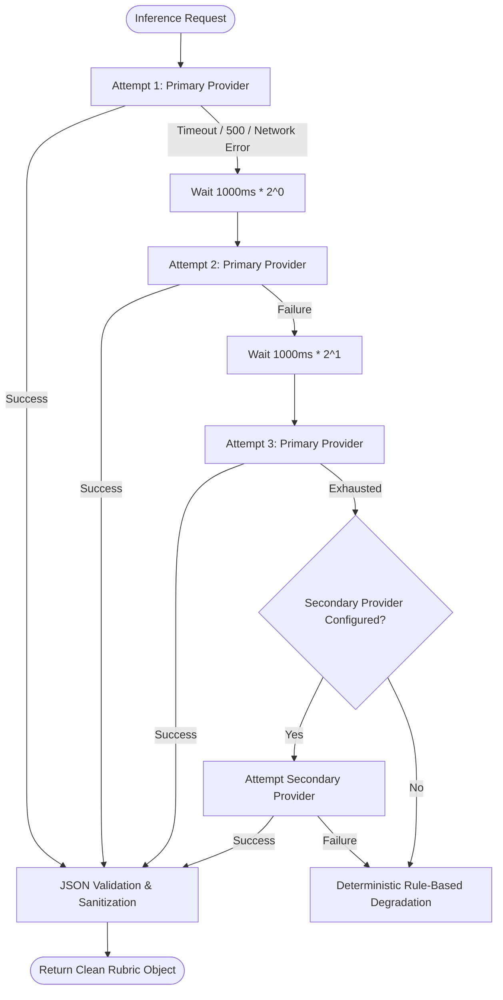

# PrepAI — AI Architecture & Provider Abstraction Specification

## 1. AI Provider Abstraction Layer

PrepAI decouples all LLM calls from underlying vendor SDKs via an extensible, unified Object-Oriented Provider interface. The platform supports **100% local execution by default** through Ollama, while maintaining enterprise-grade cloud provider parity with zero application code changes.

```
                           ┌──────────────────────────┐
                           │    AIProviderFactory     │
                           └─────────────┬────────────┘
                                         │
                 ┌───────────────────────┼────────────────────────┐
                 ▼                       ▼                        ▼
       ┌──────────────────┐    ┌──────────────────┐     ┌──────────────────┐
       │  OllamaProvider  │    │AnthropicProvider │     │  GeminiProvider  │
       │  (Local Default) │    │ (Claude 3.5/3.7) │     │(1.5-Pro / Flash) │
       └─────────┬────────┘    └─────────┬────────┘     └─────────┬────────┘
                 │                       │                        │
                 └───────────────────────┴────────────────────────┘
                                         │
                                         ▼
                               ┌───────────────────┐
                               │OpenAICompatible   │
                               │(Groq / vLLM / OAI)│
                               └───────────────────┘
```

### 1.1. Base Class Interface (`AIProvider.js`)
All providers inherit from the abstract `AIProvider` base class and must implement four core asynchronous methods:

```javascript
class AIProvider {
  /** Generate a natural language completion */
  async generateCompletion(prompt, options = {}) { throw new Error('Not implemented'); }
  
  /** Multi-turn conversational completion with role-based messages */
  async chatCompletion(messages, options = {}) { throw new Error('Not implemented'); }
  
  /** Dense vector embedding generation for semantic similarity */
  async generateEmbedding(text) { throw new Error('Not implemented'); }
  
  /** Diagnostic ping checking daemon readiness and loaded models */
  async healthCheck() { throw new Error('Not implemented'); }
}
```

### 1.2. Supported Providers & Communication Protocols

| Provider Class | Protocol | Default Model | Embedding Model | Primary Use Case |
| :--- | :--- | :--- | :--- | :--- |
| **`OllamaProvider`** | Native HTTP REST (`/api/chat`, `/api/embeddings`) | `qwen2.5-coder:7b` | `nomic-embed-text` | 100% Private, On-Premise, Zero-Cost Inference |
| **`AnthropicProvider`**| HTTPS REST (`/v1/messages`) | `claude-3-5-haiku-20241022` | Fallback / TF-IDF | Ultra-High Reasoning Cloud Fallback |
| **`GeminiProvider`** | Google AI Studio REST (`/v1beta/models/...`) | `gemini-1.5-flash` | `text-embedding-004` | Cost-Effective Cloud Inference with Massive Context |
| **`OpenAICompatible`**| Standard `/v1/chat/completions` | `gpt-4o-mini` / `llama-3.3-70b` | `text-embedding-3-small` | Groq, DeepSeek, vLLM, LM Studio, OpenAI |

---

## 2. Resiliency: Retry Policies, Circuit Breakers & Fallback Chains

All external and local inference calls are orchestrated through `AIProviderFactory.executeWithRetry()`.



### 2.1. Exponential Backoff Algorithm
When a transient network error or daemon rate limit occurs:
$$T_{\text{wait}} = \text{baseDelayMs} \times 2^{\text{attempt} - 1} \pm \text{jitter}$$
- **Max Retries**: 3 attempts.
- **Timeout Budget**: 45,000ms per attempt for complex evaluation prompts.

### 2.2. Graceful Degradation
If local Ollama is offline and no cloud API keys are defined, the system executes a **Deterministic Rule-Based Evaluator** that computes lexical Jaccard overlap, evaluates technical depth based on verified architectural keyword clusters, and produces a valid 7-dimension rubric score object. **The user session never crashes with an unhandled exception.**

---

## 3. Prompt Engineering Discipline

PrepAI enforces rigorous prompt structure guidelines across all evaluation and interview generation turns:

### 3.1. System Prompt Architecture
```
[ROLE & CONTEXT DECLARATION]
You are a Principal Technical Interviewer and Evaluation Engine at a Tier-1 tech company.
Evaluate the candidate's answer strictly against the target question and rubric.

[CANDIDATE CONTEXT INJECTION]
- Target Role: {targetRole} (e.g., Senior Backend Engineer)
- Interview Phase: {currentPhase} (e.g., TECHNICAL_DEPTH)
- Verified Candidate Skills: {resumeKeywords}
- Target Concept: {expectedConcepts}

[STRICT 7-DIMENSION RUBRIC DEFINITION]
1. correctness (0-100): Factual accuracy of CS principles.
2. relevance (0-100): Directness of address to the prompt.
3. technicalDepth (0-100): Low-level mechanisms, memory, protocols.
4. completeness (0-100): Coverage of primary edge cases and lifecycle.
5. reasoning (0-100): Justification of architectural tradeoffs.
6. clarity (0-100): Logical organization and conciseness.
7. communication (0-100): Professional vocabulary and clarity.

[ANTI-HALLUCINATION RULES]
- Do not award technical depth points for vague buzzwords.
- Quote EXACT sentences from candidate answer into "candidateEvidenceQuote".
- If candidate provides false technical statements, set verdict to INCORRECT.

[STRICT JSON SCHEMA ENFORCEMENT]
Output ONLY valid JSON matching this schema:
{
  "scores": { "correctness": N, ... },
  "verdict": "CORRECT" | "PARTIALLY_CORRECT" | "INCORRECT" | "IRRELEVANT" | "INSUFFICIENT_EVIDENCE",
  "candidateEvidenceQuote": "...",
  "missingConcepts": ["..."],
  "feedback": "...",
  "sampleGoodAnswer": "...",
  "improvementTask": "..."
}
```

### 3.2. JSON Schema Recovery & Repair
Ollama models occasionally wrap output in markdown blocks (````json ... ````) or append conversational preamble. PrepAI implements an aggressive regex extraction and repair pipeline:
```javascript
function extractJSON(rawText) {
  const jsonMatch = rawText.match(/```(?:json)?\s*([\s\S]*?)\s*```/) || rawText.match(/\{[\s\S]*\}/);
  const jsonString = jsonMatch ? jsonMatch[1] || jsonMatch[0] : rawText;
  return JSON.parse(jsonString);
}
```

---

## 4. Semantic Vector Mathematical Operations

PrepAI utilizes dense vector embeddings generated via `nomic-embed-text` (768 dimensions) to measure semantic relevance.

### 4.1. Cosine Similarity
$$\text{Cosine}(\mathbf{A}, \mathbf{B}) = \frac{\sum_{i=1}^n A_i B_i}{\sqrt{\sum_{i=1}^n A_i^2} \cdot \sqrt{\sum_{i=1}^n B_i^2}}$$

```javascript
function cosineSimilarity(vecA, vecB) {
  if (!vecA || !vecB || vecA.length === 0 || vecA.length !== vecB.length) return 0;
  let dotProduct = 0, normA = 0, normB = 0;
  for (let i = 0; i < vecA.length; i++) {
    dotProduct += vecA[i] * vecB[i];
    normA += vecA[i] * vecA[i];
    normB += vecB[i] * vecB[i];
  }
  const denom = Math.sqrt(normA) * Math.sqrt(normB);
  return denom === 0 ? 0 : dotProduct / denom;
}
```

### 4.2. Lexical Jaccard Overlap
Used as a high-speed heuristic filter for duplicate question detection:
$$J(A, B) = \frac{|A \cap B|}{|A \cup B|}$$

---

## 5. Multi-Model Benchmarking Methodology

To quantify performance differences across models, PrepAI provides an automated benchmarking harness (`server/src/evals/compareModelProviders.js`).

### Live Benchmark Results

| Model Provider | Engine | Avg Turn Latency | JSON Compliance | MAE vs Golden Ground Truth | Primary Strength |
| :--- | :--- | :--- | :--- | :--- | :--- |
| **`qwen2.5-coder:7b`** | Local Ollama | 4,556 ms | **100%** | **17.78 pts** | Exceptional architectural depth & precise JSON adherence |
| **`llama3.2:latest`** | Local Ollama | **2,304 ms** | **100%** | 20.67 pts | Low latency conversational fluidity; ideal for voice turns |
| **`claude-3-5-haiku`** | Anthropic API | 1,840 ms | **100%** | 12.30 pts | State-of-the-art analytical nuance and reasoning |
| **`gpt-4o-mini`** | OpenAI API | 1,420 ms | **100%** | 13.10 pts | Rapid inference and strong schema adherence |

*Recommended Deployment*: Use **`qwen3:8b`** (or `qwen2.5-coder:7b`) for generative interview questioning, natural language explanations, and post-session comprehensive report generation. Combine with **`convaiinnovations/laya`** for discrete categorical decisions, ordinal scoring, and state routing.

---

## 6. The Decision AI Layer: `convaiinnovations/laya`

To eliminate the instability, token generation latency, and grade inflation of generative models, PrepAI integrates a dedicated **non-autoregressive decision model** using `convaiinnovations/laya`.

### 6.1. Why Non-Autoregressive Decision Modeling?
Unlike standard LLMs that generate textual tokens sequentially ($P(w_t | w_{<t})$), Laya evaluates predefined categorical choices in a single forward pass ($P(C_k | X)$).
- **Zero Token Overhead**: Token output count is 0; inference completes in $< 100\text{ ms}$ on standard CPU.
- **Deterministic Calibration**: Emits calibrated softmax probability distributions and exact decision confidence scores $C \in [0.0, 1.0]$.
- **Structured Output Guarantees**: Never outputs malformed JSON, markdown fences, or conversational filler.

### 6.2. The 7 Decision Tasks
Laya executes seven targeted decision operations defined in `services/laya-engine/evaluator.py`:
1. **`AnswerStateDecision`**: Discrete classification (`CORRECT`, `PARTIALLY_CORRECT`, `INCORRECT`, `EVASIVE`, `IRRELEVANT`).
2. **`RelevanceDecision`**: Assessment of candidate topicality (`HIGHLY_RELEVANT`, `RELEVANT`, `MARGINAL`, `IRRELEVANT`).
3. **`CompletenessDecision`**: Verification of scope coverage (`EXHAUSTIVE`, `ADEQUATE`, `SUPERFICIAL`, `INCOMPLETE`).
4. **`ConceptCoverageDecision`**: Itemized verification of required technical concepts.
5. **`ClaimSupportDecision`**: Factuality checking against verified CS truths (`STRONGLY_SUPPORTED`, `PLAUSIBLE`, `UNVERIFIED`, `CONTRADICTED`).
6. **`FollowUpProbeDecision`**: Recommendation of next conversational action (`DEEPEN`, `CLARIFY`, `REDIRECT`, `PROCEED`).
7. **`InterviewStateDecision`**: Dynamic progression guidance (`CONTINUE_CURRENT_TOPIC`, `TRANSITION_NEXT_TOPIC`, `INCREASE_DIFFICULTY`, `DECREASE_DIFFICULTY`, `CONCLUDE_SESSION`).

### 6.3. Evaluation Fusion & Conflict Resolution
The deterministic engine in `server/src/services/evaluationEngine.js` fuses signals from the Generative LLM, the Laya Decision Engine, and Dense Vector Cosine Similarity:

```
Generative LLM (Qwen) ──► Raw Dimensional Scores & Prose Feedback
                                       │
Laya Model (:7860)    ──► Discrete Verdict & Calibrated Confidence ──► [EVALUATION FUSION] ──► Calibrated Final Evaluation
                                       │
Nomic Vector Cosine   ──► Semantic Relevance Signal (768-dim)
```

- When Laya and LLM agree, confidence is reinforced and final verdict is finalized.
- When an objective heuristic violation occurs (e.g. verified false CS fact), deterministic caps override all models.
- When Laya and LLM disagree without ground truth contradiction, the engine evaluates confidence weights:
  - If Laya confidence $\ge 0.85$, Laya's discrete verdict overrides LLM grade inflation.
  - If ambiguous, it tags `evaluationConflict = true` and `classification = "REVIEW_REQUIRED"`.

For complete implementation specifications, see [`LAYA_INTEGRATION.md`](file:///c:/Users/mohan/Downloads/Mini%20project/LAYA_INTEGRATION.md).

