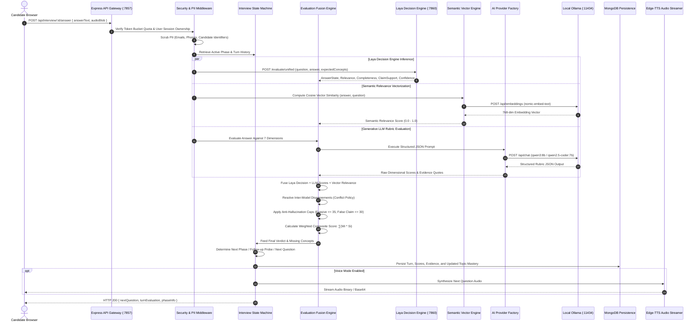

# PrepAI — System Architecture Specification

## 1. Architectural Philosophy: The 4-Layer Hybrid AI Architecture

PrepAI is architected around a non-negotiable core tenet: **strict separation of probabilistic generative AI from non-autoregressive decision models and deterministic business logic**. 

In conventional AI prototypes, large language models are frequently tasked with scoring calculations, session state progression, and database mutations within single uncontrolled prompts. This creates severe vulnerability to model drift, prompt injection, random hallucination, and scoring volatility.

PrepAI eliminates these vulnerabilities through a robust **4-Layer Hybrid AI Architecture**:

```
┌────────────────────────────────────────────────────────────────────────┐
│ 1. DETERMINISTIC ENGINE LAYER (Node.js / Express :7857)                │
│                                                                        │
│  [Rate Limiting (Token Bucket)] ──> [Auth & IDOR] ──> [PII Scrubbing]  │
│         │                                                              │
│  [Interview State Machine (8 Phases)] <──> [Adaptive Topic EMA Engine] │
│         │                                                              │
│  [Evaluation Fusion Layer] ──> [Hard Score Caps (Evasive <= 35, False <= 30)]
│         │                                                              │
│  [Weighted Rubric Scoring: ∑(Wi * Si) = Final Score (∑ Wi = 1.0)]      │
└───────────────┬───────────────────────────────┬────────────────────────┘
                │                               │
                ▼                               ▼
┌───────────────────────────────┐ ┌──────────────────────────────────────┐
│ 2. GENERATIVE AI LAYER        │ │ 3. DECISION AI LAYER                 │
│ (Ollama / Cloud Fallback)     │ │ (FastAPI Python Microservice :7860)  │
│                               │ │                                      │
│ Model: Qwen (qwen3:8b /       │ │ Model: convaiinnovations/laya        │
│ qwen2.5-coder:7b)             │ │ Non-autoregressive, 0-token overhead │
│                               │ │                                      │
│ - Natural conversational flow │ │ - Discrete verdict classification    │
│ - Contextual question design  │ │ - Ordinal quality scoring & confidence│
│ - Exemplar formulation        │ │ - Technical concept coverage checks  │
│ - Evidence quotation          │ │ - Interview state progression routing│
└───────────────┬───────────────┘ └──────────────────┬───────────────────┘
                │                                    │
                └─────────────────┬──────────────────┘
                                  │
                                  ▼
┌────────────────────────────────────────────────────────────────────────┐
│ 4. EMBEDDING & VECTOR LAYER (Local Ollama :11434)                      │
│                                                                        │
│ Model: nomic-embed-text (768-dimensional dense vectors)                │
│ - Cosine similarity semantic relevance (informational signal only)     │
│ - Strictly decoupled: Semantic similarity != Technical correctness    │
└────────────────────────────────────────────────────────────────────────┘
```

1. **The Model Proposes, The Engine Disposes**: LLMs provide raw dimensional ratings, conceptual gap identification, and natural language explanations. Laya delivers discrete classifications with confidence scores. The **deterministic evaluation engine** fuses these signals, enforces mathematical score weighting ($\sum W_i = 1.0$), executes heuristic boundary checks (evasive answer caps, false claim penalties), and resolves any inter-model disagreements.
2. **State Progression is Deterministic**: An 8-phase finite state machine (`InterviewStateMachine`) controls interview progression, determines when to trigger follow-up technical probes based on missing concepts, and suppresses duplicate questions using word-token Jaccard/overlap analysis.
3. **Local-First Privacy**: By default, inference executes on an on-premise or local Ollama daemon (`qwen3:8b` + `nomic-embed-text`) and local Python microservice (`convaiinnovations/laya`), ensuring zero candidate data leakage to third-party cloud providers.

---

## 2. End-to-End Request-Response Lifecycle

The following sequence diagram illustrates the lifecycle of a candidate answering a technical question:



---

## 3. Subsystem Breakdown

### 3.1. Interview State Machine (`interviewStateMachine.js`)
The interview follows an explicit 8-phase finite state machine:

| Phase Index | Phase Identifier | Target Turn | Focus Area |
| :--- | :--- | :--- | :--- |
| **0** | `INTRODUCTION` | Turn 1 | Candidate introduction, role alignment, icebreaker |
| **1** | `RESUME_BACKGROUND` | Turn 2 | Projects, architectural decisions, claimed stack |
| **2** | `TECHNICAL_BASICS` | Turn 3 | Core computer science concepts, language fundamentals |
| **3** | `TECHNICAL_DEPTH` | Turn 4 | Concurrency, memory models, database internals |
| **4** | `PROBLEM_SOLVING` | Turn 5 | Algorithmic optimization, edge-case debugging |
| **5** | `SYSTEM_SCENARIO` | Turn 6 | Distributed systems, caching, scaling tradeoffs |
| **6** | `BEHAVIORAL_HR` | Turn 7 | Conflict resolution, mentoring, cross-team engineering |
| **7** | `FINAL_WRAPUP` | Turn 8+ | Candidate reverse questions, comprehensive report compilation |

#### Dynamic Probing Engine
When a candidate provides an incomplete answer (`PARTIALLY_CORRECT` verdict or score $< 60$), the state machine triggers a **targeted technical probe** on the exact missing architectural concept rather than immediately advancing to an unrelated topic. Subsequent turns transition back to standard phase progression.

#### Duplicate Question Suppression
Proposed questions are tokenized and checked against previous turns using Jaccard and Overlap similarity coefficients:
$$\text{Similarity}_{\text{overlap}} = \frac{|T_{\text{proposed}} \cap T_{\text{previous}}|}{\min(|T_{\text{proposed}}|, |T_{\text{previous}}|)}$$
If $\text{Similarity}_{\text{overlap}} \ge 0.70$ or $\text{Similarity}_{\text{jaccard}} \ge 0.55$, the proposed question is rejected, prompting re-generation.

---

### 3.2. Multi-Stage 7-Dimension Rubric Evaluator (`evaluationEngine.js`)
Every technical response is evaluated across seven weighted dimensions:

$$\text{Overall Score} = 0.25 S_{\text{correct}} + 0.15 S_{\text{relevance}} + 0.15 S_{\text{depth}} + 0.15 S_{\text{complete}} + 0.10 S_{\text{reasoning}} + 0.10 S_{\text{clarity}} + 0.10 S_{\text{comm}}$$

- **Deterministic Hard Caps**:
  - Responses under 10 words or evasive phrases (*"I don't know"*, *"skip this"*) are hard-capped at a score of $\le 35$ and assigned verdict `INSUFFICIENT_EVIDENCE`.
  - Responses containing objectively false technical claims (e.g., claiming Redis is single-threaded CPU-bound or HTTP/2 creates new TCP connections per asset) are hard-capped at $\le 30$ and assigned verdict `INCORRECT`.
- **Evidence Extraction**: The engine extracts exact verbatim substrings from the candidate's response to validate where credit was awarded.

---

### 3.3. Semantic Vector Math Engine (`semanticEngine.js`)
Uses Ollama `nomic-embed-text` to generate 768-dimensional normalized dense vectors.
- Cosine similarity between candidate answer and canonical technical concepts:
  $$\cos(\theta) = \frac{\mathbf{u} \cdot \mathbf{v}}{\|\mathbf{u}\|_2 \|\mathbf{v}\|_2}$$
- Semantic relevance score acts strictly as an informational signal; it is **never** used alone to determine technical correctness.

---

### 3.4. Adaptive Topic Mastery Engine (`adaptiveEngine.js`)
Tracks student performance on a per-topic basis (`Database Internals`, `Concurrency`, `Distributed Caching`, `Networking`, `System Design`) utilizing an Exponential Moving Average (EMA):

$$\text{EMA}_{t} = \alpha \cdot \text{Score}_t + (1 - \alpha) \cdot \text{EMA}_{t-1} \quad (\alpha = 0.35)$$

Mastery is mapped to 5 normalized bands:
- **`Advanced`** ($\ge 85$): Promoted to Staff / Bar Raiser architectural scenarios.
- **`Strong`** ($70 - 84$): Challenged with edge-case and deep trade-off questions.
- **`Intermediate`** ($55 - 69$): Maintained on standard core technical questions.
- **`Developing`** ($35 - 54$): Reinforced with targeted conceptual foundational questions.
- **`Beginner`** ($< 35$): Provided foundational conceptual reinforcement.

---

### 3.5. Audio & TTS Streaming Pipeline
- **Synthesis Engine**: Uses `msedge-tts` to generate high-fidelity, natural human speech.
- **Audio Output**: Streams audio binary over HTTP response directly to the client browser Web Audio API context for zero-latency, stutter-free playback.
- **Fallback**: Browser native `window.speechSynthesis` acts as a client-side graceful degradation path if the audio streaming service is unreachable.

---

## 4. Architectural Data Flow & Component Mapping

| Subsystem Component | File Location | Responsibility |
| :--- | :--- | :--- |
| **Generative LLM Engine** | `server/src/services/providers/` | Qwen (`qwen3:8b`/`qwen2.5-coder`) provider, retry policy, health check, fallback |
| **Laya Decision Microservice** | `services/laya-engine/` | Non-autoregressive decision model (`convaiinnovations/laya`), FastAPI server (:7860) |
| **Laya Node.js Client** | `server/src/services/layaClient.js` | HTTP client connector, retry, health ping, deterministic fallback |
| **Evaluation Fusion Engine** | `server/src/services/evaluationEngine.js` | 7-dimension scoring, Laya/LLM fusion, conflict policy, anti-hallucination caps |
| **State Machine** | `server/src/services/interviewStateMachine.js` | 8-phase flow, gap-triggered follow-up probing, duplicate guard |
| **Semantic Vector Math** | `server/src/services/semanticEngine.js` | Dense vector embeddings (`nomic-embed-text`), cosine math, lexical overlap |
| **Adaptive Topic Engine** | `server/src/services/adaptiveEngine.js` | Topic mastery tracking, Bayesian EMA calculation, band progression |
| **Security & Rate Limiting**| `server/src/middleware/rateLimiter.js` | In-memory token bucket rate limiter, burst protection |
| **PII & Data Sanitation** | `server/src/middleware/piiScrubber.js` | Regex-based redactor for personal identity markers |
| **Evaluation Benchmark** | `server/src/evals/runFullBenchmark.js` | 120-test golden validation suite with statistical metrics |

---

## 5. Architectural Deep Dives

For exhaustive documentation on specific subsystems, consult the dedicated specifications:
- **Laya Decision Engine**: [`LAYA_INTEGRATION.md`](file:///c:/Users/mohan/Downloads/Mini%20project/LAYA_INTEGRATION.md)
- **Adaptive Topic Mastery**: [`ADAPTIVE_ENGINE.md`](file:///c:/Users/mohan/Downloads/Mini%20project/ADAPTIVE_ENGINE.md)
- **120-Scenario Golden Benchmark**: [`BENCHMARKS.md`](file:///c:/Users/mohan/Downloads/Mini%20project/BENCHMARKS.md)
- **AI Provider Abstraction**: [`AI_ARCHITECTURE.md`](file:///c:/Users/mohan/Downloads/Mini%20project/AI_ARCHITECTURE.md)
- **7-Dimension Rubric**: [`EVALUATION_ENGINE.md`](file:///c:/Users/mohan/Downloads/Mini%20project/EVALUATION_ENGINE.md)
- **API Endpoints**: [`API.md`](file:///c:/Users/mohan/Downloads/Mini%20project/API.md)
- **Database Schemas**: [`DATABASE.md`](file:///c:/Users/mohan/Downloads/Mini%20project/DATABASE.md)
- **Deployment & Production Runbook**: [`DEPLOYMENT.md`](file:///c:/Users/mohan/Downloads/Mini%20project/DEPLOYMENT.md)

